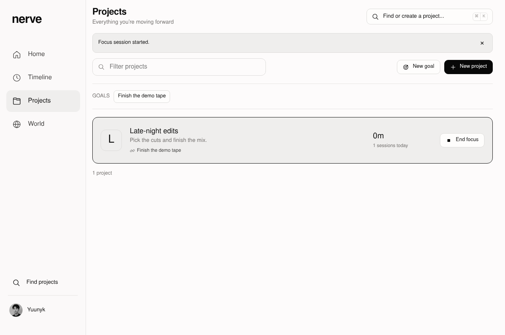

# Nerve

A focus timer should know what you're working toward.

Nerve puts goals, projects, and focus sessions in the same browser app. Link a project to a goal, spend time on it, and see where that time went.

**[Open the browser demo](https://yunykk.github.io/Nerve/)**



*The Projects view with an example goal and a running session.*

## Try one loop

1. Create a goal from **Home**. Then create a project under **Projects** and link it to the goal.
2. Start focus on the project. Only one session can run at a time.
3. End the session and open **Timeline** to see what happened. Open **World** to see the project and goal connected.

Use **Ctrl/⌘ + K** to find a project by name or description.

## Under the hood

React sends commands to the domain store. The store validates them, saves immutable events to browser storage, and replays the events to reconstruct the current state. Home, Projects, Timeline, and World read from that same state. [Architecture notes](docs/architecture.md) · [Development log](DEVLOG.md)

## Run locally

For an authorized checkout, use Node.js 22.12+ and npm.

```bash
npm ci
npm run dev
```

Open the Vite URL printed in the terminal. It is usually `http://localhost:5173`.

<details>
<summary>Development checks</summary>

```bash
npm run typecheck
npm run lint
npm test
npm run build
npx playwright install chromium
npm run test:visual
```

The browser suite covers linking a project to a goal, timing a session, and checking Timeline and World.

</details>

## Current limits

Data belongs to this browser profile and site origin. Clearing site data removes it. There is no account, sync, or built-in export/import recovery.

The source is available for inspection under the [repository license](LICENSE).
