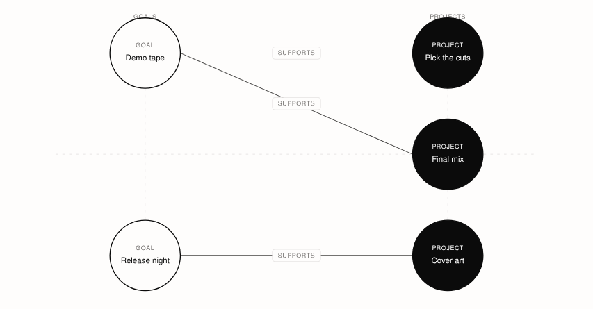

# Nerve

**i wanted the timer to remember what the work was for.**

In Nerve, a focus session belongs to a project. A project can point back to a goal. Put in a little time and you can see what it went toward.

**[Open Nerve in your browser](https://yunykk.github.io/Nerve/)**



*World with a demo tape and release night mapped out.*

## Give it one thing to remember

1. On **Home**, make a goal. Try “finish the demo tape.”
2. In **Projects**, add “late-night edits” and link it to that goal. Start focus, then end the session. Nerve runs one focus session at a time.
3. Open **Timeline** to see what happened. Open **World** to see what connects.

You can jump to a project with **Ctrl/⌘ + K**.

<details>
<summary>What happens when you click Start focus?</summary>

React sends a command to the domain store. The store checks that another focus session isn't active and appends an immutable event to browser storage. It replays events to rebuild the state that Home, Projects, Timeline, and World read. [Architecture notes](docs/architecture.md) · [Development log](DEVLOG.md)

</details>

## Run locally

For an authorized checkout, use Node.js 22.12+ and npm.

```bash
npm ci
npm run dev
```

Open the Vite address printed in the terminal, usually `http://localhost:5173`.

<details>
<summary>Development checks</summary>

```bash
npm run typecheck
npm run lint
npm test
npm run build
npx playwright install chromium
npm run test:visual
```

The browser suite links a project to a goal, times a focus session, and checks Timeline and World.

</details>

## Where the data lives

Data belongs to the browser profile and site origin where you created it. Clearing site data removes it. There's no account, sync, or built-in export/import recovery.

The source is available for inspection under the [repository license](LICENSE).
