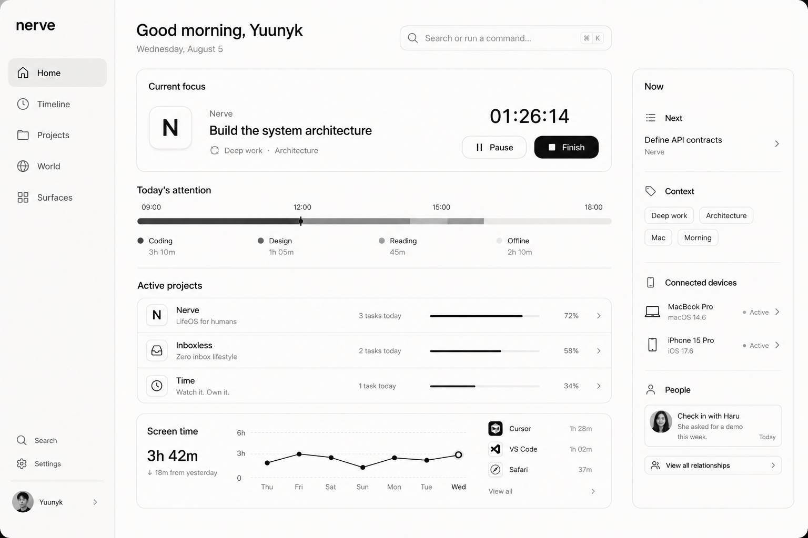

# Nerve

> A local-first personal operating system for connecting goals, projects, and focused time.

[](https://github.com/Yunykk/Nerve/actions/workflows/ci.yml)
[](https://github.com/Yunykk/Nerve/actions/workflows/deploy-pages.yml)
[](LICENSE)

**[Open the live demo](https://yunykk.github.io/Nerve/)**



Nerve is a working product slice built around one idea: goals, projects, focus
sessions, and history should be different views of the same system—not isolated
productivity widgets. It runs entirely in the browser and persists an immutable
event stream locally, with no account or backend required.

## What you can do

- Create goals and projects.
- Connect a project to one or more goals.
- Start and stop a globally exclusive focus session.
- See live and per-project focused-time totals for the current day.
- Filter projects by name or description (`Ctrl/⌘ + K` opens the finder).
- Inspect every change in a newest-first Timeline.
- Explore goals, projects, and their relations in the World graph.
- Reload the app without losing data.

## Architecture

```text
React UI
   ↓ command
NerveStore
   ↓ validated immutable event
EventStorage (localStorage)
   ↓ replay
Domain projection → Home / Projects / Timeline / World
```

The event stream is the source of truth. Commands validate domain invariants before
persisting, and the current state is deterministically rebuilt by replaying stored
events. UI components never access `localStorage` directly, so a remote storage
adapter can be introduced without rewriting the views.

Important invariants include:

- only one focus session can run at a time;
- relations must connect an existing project to an existing goal;
- duplicate relations and identifiers are rejected;
- stale-tab appends are replay-validated before storage is replaced;
- daily duration calculations correctly clip sessions at local-day boundaries.

See [the architecture notes](docs/architecture.md) and [development log](DEVLOG.md)
for the design decisions and extension points.

## Tech stack

- React 19 and TypeScript 6
- Vite 8
- Vitest for domain and persistence tests
- Playwright for the end-to-end product flow
- Plain CSS and inline SVG; no UI or graph framework
- GitHub Actions and GitHub Pages

## Run locally

Requirements: Node.js 22.12+ and npm 10+.

```bash
git clone https://github.com/Yunykk/Nerve.git
cd Nerve
npm ci
npm run dev
```

The development URL is normally `http://localhost:5173`. Browser data is stored
under the `nerve:event-stream:v1` localStorage key and never leaves the device.

## Quality checks

```bash
npm run typecheck
npm run lint
npm test
npm run build
npm run test:visual
```

The Playwright suite covers the complete baseline journey: create a goal, create a
project, connect them, start and stop focus, verify the Timeline, and inspect the
relation in World.

## Scope

This repository deliberately presents a focused local-first vertical slice.
Authentication, cloud sync, calendar ingestion, native clients, and AI features are
not represented by placeholder screens.

Logical next steps are event-schema migrations, entity lifecycle commands,
export/import recovery, and an optional remote `EventStorage` implementation with
offline reconciliation.

## License

[Source Available — All Rights Reserved](LICENSE)
